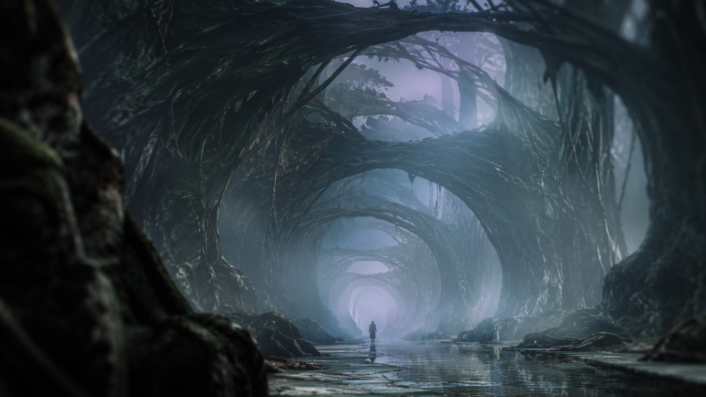
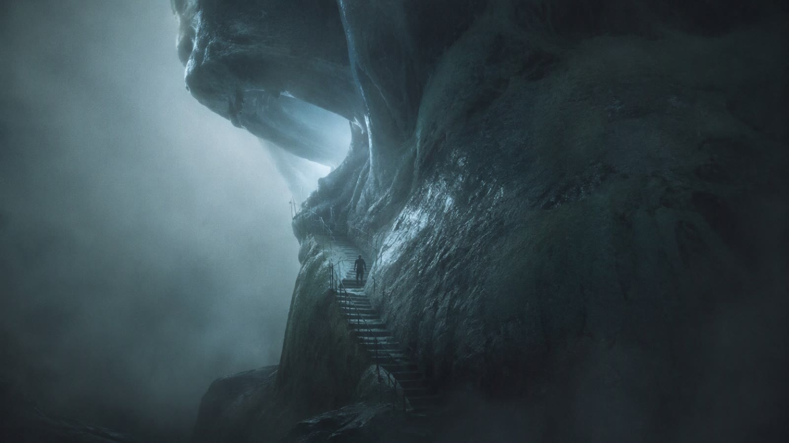
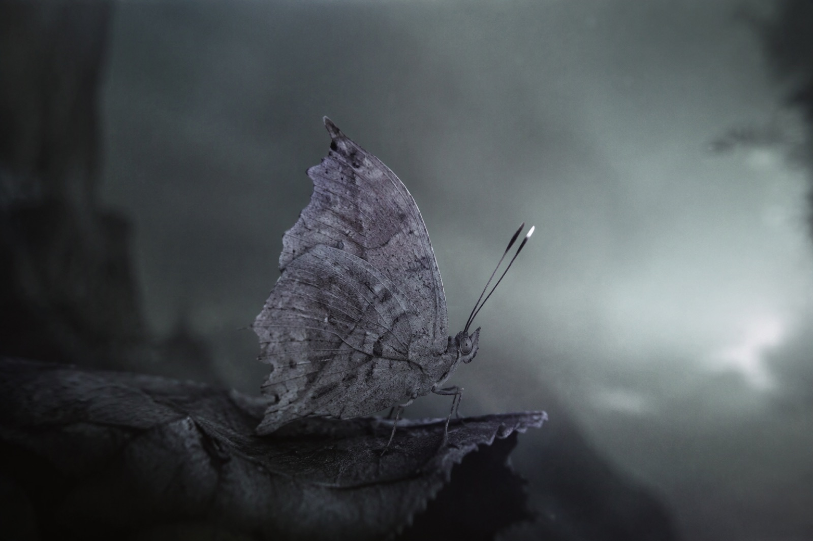

# 齐物·胡蝶 / QIWU · HUDIE

## 3A级电影化心理恐怖梦境冒险 · 09 委托入梦·蝶引概念版

网页入口现为电影式观众主题页，按「无署名委托 → 异梦之境 → 穿越、互证与改路 → 观蝶 → 清醒与代价」节选呈现本稿。`design-notes.html` 保留本版完整设计书；主页的委托函为本稿故事节选的界面演绎，滚动运镜与叠化仅为网页表现，不代表实机玩法或原视频运镜。世界观、主角身份、梦域与逃脱规则不变。

主题页的交互采用「观察 → 留痕 → 怀疑 → 醒后核对」：翻阅委托函、在梦域接缝主动记录、为蝶移焦，形成只属于本次浏览的梦中手记；醒来时核对的是用户亲手留下的观察，未查证部分仍存疑。允许空记录醒来，不强制收集；动态与叠影可“定心”关闭而不影响功能。所有线迹、纸背与焦点反馈仅是概念网页演绎，不新增正式游戏谜底或角色定论。

> 昔者庄周梦为胡蝶，栩栩然胡蝶也，自喻适志与！不知周也。俄然觉，则蘧蘧然周也。不知周之梦为胡蝶与，胡蝶之梦为周与？
>
> ——《庄子·齐物论》

**梦比你更记得你。找到它记错的地方，才能真正醒来。**

《齐物·胡蝶 / QIWU · HUDIE》是一款面向 PC 与主机的单人第三人称、3A 级电影化心理恐怖梦境冒险。名称仅为工作名，不代表商标可用性结论。你是无名梦境探索者，因一封夹在书里的信而入梦：信没有署名，也不说明那是谁的梦，只写着一件事、一个期限，和一个不许追问的问题。每次开始，桌上都有安眠药与那本旧书；书页里夹着它，首页印着庄周梦蝶，问题底下，是一段用你笔迹写下的回忆。梦不打算吓你，它打算说服你：那个更完整、更被爱、更说得通的你，才是真的。你要穿过巨物、重复与不合理相接，找到它记错的地方，带回证据，走进一个不属于它的出口。

安眠药只是虚构叙事的仪式道具。本稿不提供任何现实用药、剂量或睡眠建议，也不以精神疾病、患者或身体差异作为恐怖来源。

*参考图说明：以下所有影像均为本作原创概念图，由 gpt-image-2 按统一提示词生成，非实机画面；图中人物一律为无名剪影，不是角色定妆，人面不是已确定的怪物设计。仅研究影调、尺度与观看关系，不复制具体作品形象。*

---

## 01 世界与恐怖命题｜梦不伪造世界，它重新解释你

梦保留现实的触感，却重写尺度、时序与空间相接。每段楼梯都能行走，合起来却抵达建筑外侧；门后的房间清楚可辨，绕回外墙却容不下它。一间房的回声，可以通往另一片大陆。

这些矛盾不是威胁，是邀请：只要你接受一种解释，一切都会重新变得合理。心理恐怖也从这里开始——不是有东西追你，而是所有东西都在替你圆一个说法。

《齐物·胡蝶》的梦由当次问题牵引，不是每次固定抵达同一片林地：入口、地貌、巨物形态、重复序列与不合理相接都会出现变体。根系、茧壳、浅水与巨构只是代表性材料，近处踏步与接缝可读，整体却可能内外尺度不等、门后接回门前。梦会读你带回的记录：下一次的门更像你想要的，安慰更像你需要的。它不承诺无限随机，只承诺越来越懂你。

调查围绕三个问题：梦为何知道你的回忆，任务书上为何是你的笔迹，以及每一次"醒来"是谁批准的。记忆缺损表现为证词先后不合、记录与空间相接断裂；它们是待互证的现象，不把"失去全部记忆"定成唯一真相，也不把任何诊断当作恐怖来源。关键证据必须互证，推理必须改变路径，查证与逃脱必须得到可验证的达成。

有居民把修补梦境断点的现象称为"守夜"，这只是待查证的说法，不代表可靠机构，也不证明它写了任务书。他们的记忆彼此吻合，吻合得不像巧合；纸上的回忆片段、人物证词与意识裂隙可能互相印证，也可能一起漏掉同一件事。你主动检验它们与空间回接的关系，寻找不再被接回的出口。无名不是等待指令，更不是只能照书执行。

"守夜"不预设为等待击败的单一恶人。居民可能协助、隐瞒或真诚记错，证词不能代替环境证据。主线最终要让你确认困住自己的机制，利用已查证规则逃离；谁创造了更远处的梦可以留白，不能用一句"也许仍在梦中"撤销核心进展。

### 恐怖命题

**梦不困住你。它让你同意留下。**

它给你一段更完整的过去、一个几乎合适的名字、一种被准确理解的安慰。只要你同意一次，它就不必再证明自己是假的。恐怖不在怪物出现时，而在你发现自己的记录、笔迹与证词都在替它说话——它们互相印证，印证得比你自己的记忆更连贯。

因此查证是反抗。你让纸页片段、人物证词、环境残痕与亲身行动互相校验，找出它无法圆上的那一处，再用规则打开出口。谁敢保证自己不是被说服的那一个？

### 三项平行视觉支柱

**巨物**改变身体路径与线索尺度：它让身体与证据之间出现距离，逼近与绕行都成为取证方式，不只是放大怪物。**重复**建立时间、空间和记忆的规律：完全相同反而说明你被留在原处，少一件或多出的那一件才是线索。**不合理构造**让局部可懂、整体矛盾：近处踏步、接缝、材质可信，整体却内外尺度不等、失去支撑或邻接互斥。

三者共同服务真相与逃脱。奇观不都等于怪物，修补痕、壳体、林庭与楼梯同样承载未知。

### 3A 是体验与制作规格

可信的身体与材质、细腻表演、连续场面，以及玩家能够介入的宏大事件。不以无限地图、刷装或任务数量证明野心，内容密度与作者性优先于体量口号。3A 与获奖是目标，不是当前成果或保证。

---

## 02 扮演的身份｜你是梦境探索者，不是梦的主人

你扮演无名梦境探索者，因一封夹在书里的信入梦，目标明确：查明梦为何知道你的回忆，并找到真正醒来的路。你会接近巨构、质疑任务书、追问证词、验证空间连接，再承担改路的后果。你越接近真相，梦越清楚该用哪一种温柔留住你；力量来自观察与行动，不是统治潜意识。你不是被梦选中的，你是被一封信雇来的。

### 委托｜入梦的缘由

入梦不是自发的。每一次都从一封委托信开始，但那封信没有寄来，也没有人递给你——它只是夹在你正读的那本书里，夹在这一页。折痕是旧的，像已经被夹回去过很多次；你不记得自己夹过它，也不记得上一次读到哪一行。

- **信在哪**：书页之间，不在信封里。没有邮戳，没有落款，只有页边一行你的字迹。
- **信上写什么**：一件事（入梦、查证、带回证据）、一个期限、一个不许追问的问题。信不说明那是谁的梦，只说"你到了就知道"；书页替你补上该查的地方。
- **报酬**：不是钱。信上说，等证据带回，会告诉你一段你确实丢掉的时间里发生过什么。梦许诺的，正是同一件东西——这是整部作品最容易忽略的一处对称。
- **不对的地方**：落款栏空着，页边备注却是你的笔迹；期限在你复述时少了一天；同一页书里还有别的折痕，像夹过别的信，而信纸是同一张。

委托既是叙事装置，也是节奏装置：一封信对应一场梦、一个问题、一次可以达成的清醒，不做无限任务列表。它让"为什么又入梦"有答案，也让玩家每次都要重新确认：这封信是谁写的，证据又要交给谁。写信的人与那本书的来源保留为待解问题，不用一句反转撤销已经成立的查证与逃离。

**不设姓名、性别、职业或既定过去。**无名不预设为失忆，而是拒绝被称呼。每场梦都会提供一个几乎合适的名字、一段几乎属于你的过去；接受一个，就等于承认它记得的你才是真的。名字是梦用来叫住你的东西。

每次启程都从同一类桌面开始：一本翻开的旧书、夹在书页里的无署名委托信、桌边的安眠药包装，以及留待补充的记录页。信没有落款，签字栏空着；书只给出当次要寻找的问题和几处不完整参照，不给答案——但字迹是你的。你决定先查哪条线索、如何跨越巨构、何时推翻纸上的推断；从梦中带回的证据由你写入记录，梦也在读你写下的每一行。

信上只写着一个问题，书把它落在纸上；翻页后却出现仿佛早已记录的回忆片段，有些句子连语气都像你。它为何比你更早知道这些细节？你进入梦中，不是为了服从书的安排，而是找到能从不同站位复查的证据，判断哪些是回忆、哪些被补写，以及出口为何会把路接回。

每份委托的问题不同，梦的入口、地貌与重复方式也不尽相同；共享的声音和残痕让你能够跨梦比对。回返后任务文字微妙更改，你保留已查证成果并标明仍有疑问的部分。成长不只是从"纸上写着，就应该相信"走向互证，也要接受：有些证据会指向一个你不愿承认的自己。清醒要能持续，不以一次假醒清空全部进展。

"借梦"让你在证据已暗示的联系间，暂时改变巨构运动与空间相接。重复提供可预测的节律，不合理构造暴露连接的边界；改动后的落点与回路必须能复查。改变一处，另一处也会回应，能力不能凭空创造答案或任意出口。

你很少解释自己。你不报名，也不交代过去——名字一出口，梦就有了称呼你的方式。面对居民、证词和任务书，你更常先看、再记，最后才说一句；台词短，避免把判断说满。古文只在需要界定"梦与醒、我与蝶"时出现，且引文准确、出处清楚。

语气示例如下，不是固定台词：

- "蝶先至。门未开。"
- "焦外有物。"
- "此物醒后犹在。"
- "这不是我的字。"
- "别替我记。"
- "方其梦也，不知其梦也。"
- "周与蝶，必有分。"

深沉来自观察顺序与克制，不来自长篇独白；最重的一句，常常只有四个字。

---

## 03 入梦仪式｜不宣布进入梦境，让现实逐渐失去确定性

每次从同一张桌子开场：那本书已经摊开，夹在里面的信落在页边，桌边是安眠药包装。任务书首页印着《齐物论》，你翻到问题页，蝶已经停在纸角，合翅，像一片不属于这间屋子的枯叶。纸页给出当次问题与不完整参照，镜头只呈现无品牌包装和手部动作的省略，不呈现服药过程。翻页声渐渐失去同步，药盒投影重复，空房另一侧像有呼吸或敲门；更糟的是，记录页上多了一行你还没有写下的字，笔迹和你一样。诡异来自日常细节的微差：折痕是旧的，像被夹回去过很多次；你合上书再打开，它还夹在同一页。不用说明性的台词解释转场。

**你还没有翻页，纸声已经响过。下一页，却像记着你尚未经历的回忆。你确认过门锁；回来时，桌上的东西被摆得更像你记忆里的样子。**

四段相连，构成一次完整的入梦：

**一、收束。**桌面从暗处浮现：安眠药包装停在桌边，委托信夹在书页间，问题旁只有半幅结构草图和一句残缺引文。你的手停在页角，镜头省略其余动作，只留下纸张纤维与药盒不止一道的投影。书翻在你没有翻到的那一页；信上的期限只到今夜，落款栏空着。你记下当次问题和参照，也留下可在醒后复查的记录，书并未承诺该相信谁。蝶停在药盒投影与纸页之间，合翅，不动；它的位置比投影更稳定。

**二、脱离。**纸页翻过，声音却停留在上一页；手指尚未移动，下一次翻页声已从空房另一侧响起。桌边药盒的投影在同一盏灯下重复，呼吸似乎隔着房间回应，又像门外一声克制的敲击；随后有人用你的声音，很轻地叫了一下。画面仍保留可辨的纸面和手部，不靠骤暗、闪烁或模糊文字宣告失控。蝶从页缝飞起，却没有翅声；它退到焦外，轮廓反而比在焦内更清楚。

**三、越界。**翻页后的文字像已经提前记录一段回忆，却仍缺少能够解释它的证据。镜头沿页缝贴近，纸纤维接成可供身体穿越的空间接缝；远处巨构的阴影越过桌沿，近处门槛仍可读。接缝另一侧的光像你小时候的房间：你不记得那间房，身体却先放松了。问题不同，落点也不固定，可能是壳体内侧、悬阶或深水边缘。蝶停在接缝边缘，翅粉落进纸纤维；你记住它停的位置，不跟它飞。

**四、抵达。**你在当次梦的入口站稳，先听见自己的呼吸慢半拍，才听见远处结构的摩擦。桌面纸声化作巨物之间的间隔，重复投影变成可测的距离。新的地貌与前次不同，共享母题却提示它们有关。第一处参照不是任务书上的图，而是蝶停下的那道接缝。局部目标是沿可达踏点接近它，从另一侧核对任务书的疑问；回返再将证据补入记录，书上措辞的微变留作新疑点，不抹去本次成果。

**入梦注记。**安眠药仅为虚构叙事道具，不构成现实用药或睡眠建议；不展示服药过程、用法或剂量。上述镜头与声距均为本作设计方向，不由参考静帧推定视频运动或原声；路径、落点与文字始终可读，重复开场允许缩短与跳过。

---

## 04 核心循环｜从查证梦，到亲手走出循环

**接委托 → 阅读任务书 → 诡异入梦 → 探索异梦 → 查证与记录 → 打开出口 → 醒后比对。**

委托只指定一场梦和一个问题，任务书把它写在纸上，你在异梦中主动取证。巨物迫使身体改变行进方式，重复让观察形成假设，不合理构造提供可复查的反证；蝶标出接缝，虚焦决定你先看见什么。每带回一次证据，梦也更懂你一分：下一次的门会更像你想要的，安慰会更像你需要的。查证因此有代价——你用过的线索，可能已被提前布置好。醒后比对保留成果，书与菜单都不替你完成调查。

### 身体进入世界

行走、攀越、游渡、借势滑行与失重穿行组成连续旅程。巨根截断近路，壳体运动形成渡越窗口，远看像纹理的裂缝要攀到高处才能读成修补痕。身体有时先认出空间：某级台阶的高度，恰好是你旧伤的走法。局部目标是抵达可复查的观察点，从内外两侧核对尺度，跨过同一门槛确认实际去向。身体遭遇与取证不可分开，不把梦拆成孤立的谜题房。

### 让重复成为可查证的规律

重复的灯列、壳纹、动作与回声先建立熟悉感，再暴露时间、空间和记忆各自的规律。完全相同反而说明你被留在了原处；少一件或多出的那一件，才是线索。差异必须能与另一种证据互证，不能只是一处随机变色。玩家先提出连接假设，再通过声距、水迹和往返路径检验；确认不合理构造的边界后，才尝试改变巨构运动与空间相接。

### 在变化中应对

巨构侧移会改变水位与可达落点，看似向内的楼梯可能把身体送到壳体外侧。玩家在渡越、躲避挤压和寻找退路中追踪这些对应，不只静站看景。改动连接后，既要趁运动窗口穿行，也要从新的站位复查旧路是否仍回接；规模体现为持续变化的行动条件，而不是拉远镜头播放灾变。

### 让证词与环境互证

居民会协助、误导、挽留，也可能把被补写的回忆当成真事。他们会说出你从未告诉任何人的细节；先别感动，先核对。你从交谈中取得线索，再用磨损、水位、重复节律与空间邻接核查先后，将互证结果和存疑之处分开写入记录；任务书的片段也接受同样检验。护送证人穿越变化区域、交换可核对的经历或暂时失去协助，会改变路线与后续相遇，不依赖善恶刻度。

### 醒来，必须经得起检验

看见熟悉桌面不等于完成逃脱。你先把梦中证据补入记录页，与入梦前抄下的问题和参照比对；真正醒来的第一个证据，往往不是光，而是一件小事没有被摆正：杯子留在你放下的位置，纸角仍是昨天折的那样。任务文字可能微变，已核实的事实仍可复查，新行动也应留下持续结果。假醒可增加认识，但不清空进展；完成局部问题可以真正达成，终段以非循环路径和持续清醒验证逃脱，代价是可能留下一小段无法补回的记忆。

**类型边界。**以探索、梦律交互、穿越与动态遭遇为主。是否配置局部对抗留待可玩验证；不为了"像 3A"强加高频战斗、刷装备或与主题无关的系统。

---

## 05 心理恐怖｜最深的恐怖，不是怪物，是梦说得比你有理

《齐物·胡蝶》以心理恐怖为整体调性：不靠血浆、怪物特写或突然惊吓，而靠被准确理解、被温柔更正、被自己的记录指认。玩家始终保有行动能力；恐惧来自"无法证明哪一个自己是真的"，不来自无力挣扎。梦不靠追杀留住人，它靠说服。

### 四种机制

**01 被认识 / BEING KNOWN**

梦说出你从未告诉任何人的细节，用你熟悉的语气安慰你。亲密越准确，越像捕获；它不追问你在怕什么，它直接替你把它说出来。

在游戏中如何成立：居民与任务书先于你的提问给出答案，答案准确到让你想感谢它。你把这种准确当作线索追下去，追得越深，越是在确认"它确实了解我"——而这份确认本身就是它要的进展。玩家能验证的只是细节为真，无法验证的是它为何知道；恐怖来自准确，而不是来自威胁。你仍然可以转身离开，但离开之后会发现自己记住了那句安慰。

**02 追溯改写 / RETROACTIVE CORRECTION**

证词、照片、记录与空间互相修正，直到彼此吻合。唯一对不上的，是蝶停下的那道接缝；你得在它把这一处也补上之前动手。

在游戏中如何成立：回返后，证词、磨损、水位与记录的先后顺序会被重新对齐，让上一轮的矛盾消失；但你已经抄下的问题、画下的草图与带出的翅粉不会跟着改。于是玩家手上总有一小份"旧版本"，可以指认哪一处被更正过。改写从不彻底，它只是让多数人放弃比对。同一处接缝在两次梦中出现不同停法，是最直接的差异证据。

**03 自证 / TESTIFYING AGAINST YOURSELF**

你必须用梦可能伪造的证据证明你是你。记录越完整，越难判断哪一页不是自己写的；这正是它需要你写下去的原因。

在游戏中如何成立：证人与出口都会要求你提供只有你能提供的过去——一件旧事的细节、一个称呼、一段语气。你写下的每一段都会被梦读走，成为它下一次扮演你的材料；写得越完整，越难分清哪一页出自你手。玩家因此要在"留下证据"与"留下破口"之间权衡，而不是收集得越多越安全。已核实的事实不会因书写而被撤销，这是玩家仍能自证的最后支点。

**04 同意 / ONE YES IS ENOUGH**

出口要求你接受一个版本：放弃一段真实记忆，或留下，成为一个更完整的假人。梦不需要你相信它，只需要你同意一次。

在游戏中如何成立：所有说服都收束到一次同意。同意之后，路立刻变得好走，称呼立刻变得合适，解释立刻变得完整——玩家会亲眼看见"合理"是一种奖励。拒绝不需要击败任何东西，但每一次拒绝都要付出路线、关系或身体上的代价；梦不惩罚你，它只是把代价放在你面前，再等下一次。

### 恐怖语法

恐怖由"太正常"累积，而不是由刺激堆叠：

- 日常被礼貌地纠正；
- 声音先于动作；
- 镜中迟半拍；
- 重复里少了一件；
- 亲近的人把你的过去说错，又立刻改口；
- 信上的期限比你记得的早一天；
- 焦点外的东西不追你，只是等你把视线移开。

镜头不靠闪烁、突然黑屏或扭曲人脸；声音不靠骤起音效；强刺激段落提供内容提示与强度选项，不以突袭式惊吓作为卖点。安静比爆点更可靠。

### 伦理边界

不以精神疾病、患者、身体差异或现实用药作为恐怖来源，也不做诊断展览。恐怖的对象是"被解释、被更正、被替代"，不是病人。梦中的身体与空间均为虚构设计；安眠药只承担虚构叙事的仪式功能，不提供现实睡眠或用药建议，不写现实用法与剂量。任何一段证词都不构成对现实心理状态的判定。

---

## 06 三个代表性梦域｜不是完整列表，也不是每夜固定顺序

### I. 雾白林庭

灰紫白、冷青与低伏苔色围成偏冷梦域。巨根迫使身体攀越，远处苍白壳体上的细小修补痕只有靠近才能读懂；重复的林庭与水声建立可比对的间隔。一间从外侧数步可绕完的林屋，内部却容纳漫长庭院。

这里的人会礼貌地叫出一个你没听过的称呼，然后等你纠正；纠正本身，就是登记——你说出的每一个"不是"，都在替它确认你究竟是谁。

代表性调查目的：建立可复查的尺度与时序参照，核对任务书的回忆片段。蝶常停在树根与林屋接缝之间，合翅时几乎与苔色相同；先找到它，再判断这段林庭是否重复过。

### II. 赭粉眠谷

褪粉、烟紫与锈褐围合低伏谷地，少量琥珀藏在缝隙。层叠巨壳必须攀行与绕渡，其磨损痕成为跨越数个人体高度的线索；开合节律与重复壳纹提供时间标尺。

壳体内侧留着有人替你保存的生活痕迹：杯子的缺口、椅背磨亮的位置，尺寸却对不上你。向内攀升的楼梯未穿过壳壁，却抵达壳体外侧；一段体块失去合理支撑仍随节拍移动。

调查目的：比对居民证词与结构痕迹，查清巨构运动如何重接空间、补写记忆。蝶停在巨壳修补痕的尽头；远看是一片枯叶，靠近才知是翅。

### III. 深水灯庭

冷青、深蓝紫与炭黑沉入水庭，橙灯只点亮近处湿面。巨构的运动决定游渡与攀越窗口；重复灯列和水位痕提供可回查的顺序。门后接回门前，两个互斥庭院却共用同一门槛，悬挑体块缺少合理支撑。

灯列按你的记忆排布，水位按你的说法涨落；你要在水里辨认，哪一句是自己说的，哪一句是水替你补的。

代表性调查目的：以当次观察和已带回的跨梦证据辨认伪出口，利用空间相接规则打开非循环路，完成并检验真正的醒来。蝶停在灯列缺口，不进灯下；翅粉是少数不会被水冲掉的证据。

### 三域关系

以上三域是代表性梦型，不是完整列表，也不是每夜固定顺序。冷雾、赭粉暖谷、深水冷暗各有辨识，共享湿气、声距、纸页节律与记忆残痕，让异梦之间能互相查证；入口与连接的变体仍服从可检验规则。空间矛盾是本作的设计命题，不是参考静帧已证明的拓扑。梦中人物是否独立于探索者保持开放，不预设共享梦境网络或医学解释。

---

## 07 代表性旅程｜深水灯庭，一次寻找真正出口的梦

这是一次代表性灯庭梦，指向清醒，却不是每次入梦的固定终站。这份委托当次只问："哪一道门能让回忆之后的时间继续？"并留半幅灯列与一条水位线作参照。问题下面还有一行小字："别再查了。"也是你的笔迹。

你须以多种证据查验巨构运动与空间回接，寻找出口，再醒后比对并检验清醒的持续性；巨物、重复与不合理构造共同进入行动，不靠对白宣布逃脱。

**上次入口在高处，这次你从壳体水隙进入。远灯沿熟悉的节律亮起，门却不在记得的位置。**

### I ／ 抵达：出口在眼前，门后却回到门前

带着任务书的问题，你从低处水隙进入灯庭；上次的高处入口此刻接向另一片巨壳。重复灯列仍有熟悉节律，巨构却迫使你攀越壳缘、借水道游渡。看似通向桌面的门把你送回同一灯前，而门内桌上多了一只你小时候摔缺口的杯子，位置正好在你惯用手边。门框磨痕与水迹证明不是两扇相似的门；先记录这次入口与上次的差异，再寻找门槛另一侧的独立证据，不因书上的草图就认定哪扇是真出口。

蝶停在门框磨痕上；门把你送回门前，蝶没有跟过去。

心理恐怖读法——**被认出**。这段路没有威胁，只有一句无需说出口的确认：它知道你惯用哪只手。杯子的缺口比你自己的记忆更具体，因此你很难把它当作巧合。恐怖来自"被照顾得很准确"，而不是来自被追赶。

### II ／ 互证：让证词、残痕与重复彼此作证

居民说这扇门早已送你离开，还提起一件你从未说过的往事；他们的说法彼此吻合。水位残痕却与记录页中的顺序冲突，另一场梦带回的壳体节律，又与这里的灯列复位同拍。你往返观察点、追问证人，将水迹高度、门框磨损与巨构运动交叉核验，确认当次门庭会在复位时重接。

记录页里出现一句"别再查了"，笔迹是你的，墨还没干。有人称此为"守夜"，但称呼不是幕后答案，任务书也没有因此变得可靠；已核实的连接规律与待解的来源问题分开记录。

心理恐怖读法——**证词互证与"别再查了"**。多个证人彼此吻合，吻合得像排练过；而唯一与你同一阵线的字迹，正在劝你停止。劝阻不是威胁，是关心，这让它更难拒绝。你必须把"谁在说话"与"说了什么"分开检验，这正是自证机制在此刻成立。

### III ／ 改路：错开巨构，让出口不再接回

基于已查证的复位规律，你尝试错开巨构运动，使门庭不再同时回接。沿倾斜壳体攀越、穿过根系水道，在接缝变化时确认新落点；看似向内却通往壳外的楼梯成为绕开回路的接近路线。目标是抵达不共享旧门槛的通路，从另一侧重查去向，再把验证结果补入记录。

每错开一次，梦就换一种更合身的说法：它开始用你刚证明的规则，反过来替你安排一条更舒服的路。

错开巨构时，蝶退到焦外，飞向一条没有灯的路。你记住方向，不追它。

心理恐怖读法——**梦学会你的规则**。你的每一次反证都会成为它下一次布景的依据。玩家越聪明，梦越体贴；赢下的每一局都在教它如何赢你。改路因此不是单纯的技术操作，而是一次让对手更了解你的交易。

### IV ／ 代价：离开旧路，也失去原有的庇护

错开的结构使旧灯路失去稳定支撑，水位与通行窗口变化，熟悉的返回路线不再安全。你要在移动中保护已取得的证据，也要面对出口开出的条件：带走真相，必须留下一段真实记忆作抵押。接受那个更完整的版本，路会立刻变得好走，灯也会替你把话说完。

有人不愿离开，协助不再随时可得；路线的损失不等于查证成果被取消，你仍能利用已知节律穿过巨构。旧灯路断开，蝶翅粉落在记录页上；这是不能丢的证据。

心理恐怖读法——**出口的条件**。出口不阻拦你，它只是开价：用一段真实记忆换一条好走的路。这是全篇把"同意"摆得最清楚的一次，也是最像善意的一次。你会发现拒绝并不英勇，只是更费力。

### V ／ 验证：醒来之后，时间终于继续

跨过非循环路后，你回到桌前，将门庭连接、水位与灯列的互证结果补入记录。任务书的问题悄悄换了一个词，入梦前的抄录与已查证证据仍在。你移动书页、离开再返回，新位置没有复位；窗外声响继续发展，外部回应也产生新的内容。记录、行动后果与时序共同确认清醒持续，当次查证与逃离确已达成。

醒来后蝶不在。纸缝里仍有翅粉；你把它移到光下，边缘从虚焦里慢慢变清。但你想不起自己为什么留着它——时间继续，缺口也在。

心理恐怖读法——**清醒后的缺口**。逃脱成立，代价也成立：你带走了真相，留下了一段真实记忆，且不知道该为哪一段空缺哀悼。蝶不在，翅粉还在；它证明有东西穿过了醒来的边界，却不证明你记得的全部为真。余韵不能撤销已经验证的逃脱，也不假装没有损失。

这是情绪、场面与交互的方向描述，不是固定时长、关卡答案或最终剧本。意义可以开放，玩家当下的行动目标必须清楚。

---

## 08 主旨｜梦不困住你，它让你同意留下

梦不靠追杀留住人。它给你一段更完整的过去、一个几乎合适的名字、一种被准确理解的安慰；只要你同意一次，它就不必再证明自己是假的。恐怖不在怪物出现时，而在你发现自己的记录、笔迹与证词都在替它说话。

巨物让身体与证据之间出现尺度距离；重复把熟悉感变成时间、空间和记忆的规律，也让你怀疑是哪一遍被改过；不合理构造以局部可懂、整体矛盾逼出反证。三者共同服务真相与逃脱：玩家不只发现错误，还要利用规则打开不再回返的路。

蝶是唯一贯穿所有梦的活物，也是梦里唯一不替你说话的东西。每次入梦，它总比门先出现：有时停在药盒重复的投影上，有时停在门框磨痕、灯列缺口，或一段没有支撑的楼梯边缘。它停在接缝上，提醒你哪里可以查证；也可能被梦用来引你走向写好的结局——甚至，它本就是你愿意相信的那一部分梦。**你观蝶，不随蝶。**引文给你问题，不给你答案。

观察规则只有三条：

1. **门可以是假的。**蝶停下的位置要先记录，再判断门后去向。
2. **焦内的蝶是标本，焦外的蝶才是路径。**
3. **醒来后仍留在纸上的翅粉，才算跨梦证据。**它证明有东西穿过了醒来的边界，不证明你记得的全部为真。

同一处接缝若在两次梦中出现不同停法，先记录差异，再判断谁改动了梦。

情绪曲线：**熟悉 → 失真 → 疑惑 → 发现反证 → 确认真相 → 逃离 → 余韵。**

---

## 09 视听与虚焦｜保留旧梦的柔软，不磨掉行动的线索

原创概念图确立主影像感受：潮湿幽林、水面雾、苍白体量与褪色的亲近感，橙火只在局部发生。心理恐怖不靠更黑更脏，而靠画面太正常：光线礼貌，颜色像被爱过，只有某处比例不对。网页阅读层另以午夜蓝紫、雾薰衣草、褪粉与冷青承接梦核，不改变图片原色。巨物、重复、不合理构造与虚焦是本作转译；蝶为设计设定；参考图不证明不可能拓扑或实机玩法。以下感受须后续实机校准，不反推原视频的镜头、胶片或后期参数。

### 虚焦语法：焦点不总在答案上

远景的巨构、记忆残片和飞过的蝶常先以虚焦出现；玩家要判断该把焦点交给谁。蝶在焦内像一枚被钉住的标本，退到焦外才显出真正的飞行方向。看不清的边界，正是梦可以替你补写的地方。

虚焦只作用于氛围、远景、回忆与转场。可交互的踏点、门框、可读文字和近身威胁始终保留可辨边缘；不用全屏模糊掩盖资产，也不让镜头呼吸干扰操作。焦点转移是叙事动作：你选择看清什么，也就选择暂时忽略什么。

- **焦点内：**可交互物、文字、近身威胁保持清晰。
- **焦点外：**蝶、远景巨构、记忆残片先以虚焦出现。
- **转场：**醒后前几秒仍轻微虚焦，直到纸上翅粉或某个细节对上焦。

### 电影性，不是夺走控制

探索保持稳定、可读的第三人称。镜头水平时，巨物仍压迫身体，重复仍建立参照，不合理构造仍在体块、承重与动线上成立。前景遮挡、纵深与表演形成电影性；以连续行走和回看呈现门内外互斥的关系，让玩家亲自完成观察、反证与逃离，而不是靠剪辑替空间矛盾作证。荷兰角只作偶尔辅助，不以眩晕制造深度；危险、落点与方向始终可读。

### 声音，连接两种现实

呼吸、湿地脚步、水滴与林间摩擦建立局部空间，巨构低鸣提示远超视野的体量。重复节律提供可核对的时序；门内近声却从门外另一方向抵达，构成空间相接的疑点。声音须与水迹、动作和证词互证，改路后回声去向随之改变，让玩家听见规则已被利用，而非用随机音效误导。关键线索提供字幕与视觉替代；纸页声的失同步和空房呼吸只属叙事设计，仍需与可见环境互证，不以单一声音判定真相。

### 影调六则

1. **低反差，提黑但保住中调。**暗部略抬，不将根系、落点与人物轮廓压死；苍白体不漂成纯白。中调承担苔绿、灰紫、旧粉的区分，避免一层灰幕抹平所有层次。
2. **软化边缘，不全屏模糊。**降低过度锐化与微反差，远处借空气透视逐渐收敛；近处手部、可攀边缘与方向线索仍可辨。柔软是材质、光与距离的协作，不是把焦点一起糊掉。
3. **颗粒轻，暗角克制。**若使用颗粒，只采用经过验证的真实纹理，并按输出分辨率校准强度；当前不叠加颗粒素材。暗角不吞噬侧路。
4. **湿润不等于发亮，橙火不等于 HDR。**控制湿面的镜面峰值，让雾、水与有机体各有重量。拒绝强蓝橙互补、全域高饱和与 HDR 式耀斑；灯火是局部温度。
5. **参考原色，与阅读层分开。**真实截帧已带原影调，不再叠加重滤镜；电影图保留原图色彩、比例和完整画面。文字与界面不套图像滤镜。具体数值须由后续实机与可读性测试决定。
6. **惊吓不靠突袭。**不以闪烁、突然黑屏、扭曲人脸或骤起音效制造惊吓。恐惧由"日常被礼貌纠正"累积；强刺激段落给出内容提示与强度选项。

---

## 10 文化与研究｜意象可以含蓄，设计必须清楚

中国梦文化不是菜单上的古文或装饰符号。时间错位、物我关系与梦醒之辨进入叙事和行动，服务真相查证而非身份宣言。心理恐怖让这些观念变成压力，而不是谈资：梦不是等你解释，它是先替你解释好。

巨物、重复、不合理构造必须有清楚的观看与行动职责；作品允许不同解读，却不能让玩家不知道正在查什么、为何前行。以下研究只处理"熟悉之物如何变得不可信"，不借用其角色、怪物或标志性场景。

### 五部电影：研究梦如何说服人，而不是借走它的形象

五部电影只提供辅助方法，不统领主视觉。本章旁图均为本作原创研究示意（AI 生成），不是剧照，也不复刻影片画面；影片只作文本层面研究。心理恐怖部分只借观看与叙述的方法：如何让人怀疑自己的判断，如何用亲密、重复与空间说服人。所有转译都服务巨物、重复、不合理构造与虚焦，以及寻找真相与逃脱；主影像感受来自本作原创概念图，不借用电影角色或标志性构图。

**01 盗梦空间 / Inception**（2010 · 导演 Christopher Nolan）
研究局部可信的建筑、材质与人体尺度，如何托住城市级不可能转折。奇观不只是远景展示，它必须改变人物所处空间、可达方向与行动条件。
转译到雾白林庭：巨根阻挡身体，重复庭院建立测距参照，再以内外尺度不等的林屋形成不合理构造。空间同时是一段被反复解释的过去：玩家从两侧查证反证，寻找假醒的机制线索，随后改写连接以接近出口。只保留局部可信托住整体矛盾的方法，不复制折叠街道构图、梦层设定、角色或标志性场面。
电影参考图为折叠街道画面，保留原图比例与完整画面；Photo Credit: Warner Bros. Picture — © 2010 Warner Bros. Entertainment Inc.。图源与影片资料：https://www.filmfrance.net/films/inception/

**02 红辣椒 / Paprika**（2006 · 导演 今敏）
在作品层面研究梦侵入日常的连续变形，以及群体运动如何从吸引力变成压迫。所选飞行横幅只保留自身可见的空间与方向关系，不作为游行画面的证据，也不要求继承影片色彩密度。
转译到赭粉眠谷：巨壳开合改变攀行路线，以重复节律核对记忆先后；向内攀升却抵达外侧的楼梯，成为连续变形中的结构反证。侵入不是怪物闯入，而是别人的欲望与记忆获得了你的语气。借用边界连续侵入的方法，不转译为欢庆场面，不照搬角色、游行物象或标志造型。
边界须写清：索尼官网所取的图是官方飞行都市横幅，**不是游行截图**，只作空间与方向组织的辅助观察。© 2006 Madhouse, Inc. and Sony Pictures Entertainment (Japan) Inc. All Rights Reserved. 图源与影片资料：https://www.sonypictures.com/movies/paprika

**03 入侵脑细胞 / The Cell**（2000 · 导演 Tarsem Singh；服装设计 石冈瑛子；美术设计 Tom Foden）
研究仪式化人物如何通过服装体量、材质与空间关系支配视线。服装设计与美术设计的职责不得混写。
转译到深水灯庭：巨构与近处身体建立视觉支配，重复灯列诱导伪出口，再以无合理支撑的体块和互斥门庭构成不合理构造。仪式化的观看让人无法移开视线：服装、体量与空间先替人物说完了话，玩家才意识到自己已被安排位置。目标是逃脱，而非拒绝一个身份；也不以精神疾病解释邪恶。
边界须写清：现有图为绿金空间中的**居中**仪式服装人物，**本身不作为不对称巨构的示例**，也不作本作色板。版权归影片权利方，图源 Inverse；此张图片的具体版权署名未核准。图源与评论：https://www.inverse.com/article/4538-the-cell-was-the-ultimate-turn-of-the-millenium-thriller

**04 攻壳机动队2：无罪 / Ghost in the Shell 2: Innocence**（2004 · 导演 押井守 · 动画制作 Production I.G · 音乐 川井宪次）
原片以密集引文、缓慢镜头、镜像与人偶特写建立沉思气质；真实与仿造、灵魂与程序之间没有干净界线，观看本身因此变得不可靠。此图只支持面部特写、浅景深与冷青暗部的观察，不证明影片全部色彩或本作玩法。
转译只取"先凝视、再判断"的观看方式与虚焦下的不安全感：你越凝视，越像被反向确认。蝶在焦外才显出路径，任务书引文像判词也像诱饵；玩家越想把梦看清，越要先承认对焦方式在引导自己。本作台词更短：一句判断、一次停顿，其余交给记录页与空间反证。
边界须写清：**不取**赛博格设定、角色、巴吉度猎犬或金色游行。© 2004 Shirow Masamune/KODANSHA · IG, ITNDDTD。图源与影片资料：https://screenrant.com/ghost-shell-innocence-4k-remaster

**05 去年在马里昂巴德 / Last Year at Marienbad**（1961 · 导演 Alain Resnais）
原片为黑白，严整对称的构图与重复礼仪制造空间秩序，记忆和人物关系却始终不确定。它是本作彩色、不对称梦域的**反向对照**，不能被描述为原片已有的视觉方案。
转译到雾白林庭：巨根围合身体路线，重复路径与居民说法建立熟悉感，再以内外矛盾的林屋让记忆受到反证。它提供的是"说服如何取代事实"：同一段过去被反复讲述，直到听者不再要求证据。玩家须用环境残痕核对证词，走向能够验证的醒来，而不是永远停在歧义里。
边界须写清：影片仅作文字研究，本地没有该片剧照，旁图为原创研究示意，不冒称电影图；不复制角色、庭院构图或标志性人物排列。年份按 1961。影片资料：https://www.criterion.com/films/1517-last-year-at-marienbad

**引用边界。**本章四张旁图为原创研究示意，不复用影片画面、不加改色滤镜；电影与外部视频只作方法层研究，不表示已获许可。创作转译不冒称原作者意图，三域配色不冒称电影原片色彩。公开展会或商业传播前，仍应复核 AI 生成图像的商用条款。

### 四条心理恐怖研究：不安，是熟悉之物回来了

心理恐怖的传统不是怪物谱系，而是"家、亲人、自己的字迹与声音，一旦被证明不完全属于你，最安全的地方就成为最不可靠的地方"。以下作品研究这一机制；它们是方法参考，不是本作的设定来源，也不用于对任何人作心理诊断。

- **西格蒙德·弗洛伊德《不安》（Das Unheimliche，1919）**——熟悉之物以陌生方式返回，被压抑的东西并未消失；研究"家"如何变成最不安全的地方。
- **博尔赫斯《环形废墟》（1940）**——一个人梦见另一个人，直到发现自己也被人梦见；研究"谁在梦谁"的递归，以及被造者迟来的恐惧。
- **《寂静岭2》（Team Silent，2001）**——场景、怪物与罪疚同构，雾先限制感知而非只做气氛；研究环境如何替角色说出他不敢说的部分。
- **《SOMA》（Frictional Games，2015）**——连续性与复制之争；研究"哪一个副本有资格说自己是原来的我"，以及同意为何如此危险。

### 原有文学、艺术与游戏研究

**《庄子·齐物论》梦蝶段**（传统归于庄周）提供身份与立场移动的问题，差别并未因此消失。它是任务书首页的开场与全篇的指引：蝶先于门出现，梦与醒的界线由"必有分"而非"全是梦"确认。成书与作者归属具有学术复杂性；它为"梦境探索者不是梦的主人"提供问题，而非替玩家判定真假。

**沈既济《枕中记》**以亲密物件成为入口，梦中漫长经历与醒后黍未熟形成时间对照；借鉴进入与回返的张力，不复刻功名经历。"开元七年"是故事时间，精确成文年未锁定。

**巴什拉《空间的诗学》**（1957 法文初版）提醒家屋、角落与抽屉是被居住和记忆的空间，让壮阔梦域保留亲密来源，而非只剩建筑奇观；诗性遐想不等于睡眠科学。

**黑泽明《梦》**（1990）以八个梦境段落研究色彩、行动与仪式如何建立情绪整体，不复制具体场面与人物。**塔可夫斯基《潜行者》**（1979）用于研究材料细节、持续时间和环境声音，BFI 描述机械环境声与极简电子配乐的交织；本作只取感知节奏与空间临场感。

**马格利特《错误的镜子》**（1929）保留观看并非机械复写的问题，与虚焦下的不可靠观看互为参照，不复制"巨眼与云天"的标志性构图。**埃舍尔《相对性》**（1953 年 7 月）以同一空间的多个重力参照研究局部可理解、整体不可能的组织方式，不复制楼梯拓扑与人物排列。**《爱丽丝漫游奇境》**（刘易斯·卡罗尔，1865）提醒身体尺度会改变门与钥匙的可达性，不复刻经典人物、茶会或后世影视造型。

**游戏对照**保留《Gorogoa》的可操作视觉关联与《Superliminal》的强制透视，用来明确差异：本作追求连续世界中的调查、行动与关系变化，不是放大的图格拼图、透视谜题集或走廊找不同。

研究出处：

- 梦蝶：https://plato.stanford.edu/archives/spr2023/entries/zhuangzi/
- 枕中记：https://dict.idioms.moe.edu.tw/idiomView.jsp?ID=3553&webMd=2&la=0
- 空间诗学：https://penguinrandomhousehighereducation.com/book?isbn=9780698170438
- 梦：https://www.criterion.com/films/28700-akira-kurosawas-dreams
- 潜行者：https://www.bfi.org.uk/features/andrei-tarkovsky-solaris-stalker
- 马格利特：https://www.moma.org/collection/works/78938
- 埃舍尔：https://mcescher.com/about/biography-part-3
- 爱丽丝：https://gutenberg.org/files/11/11-h/11-h.htm
- 游戏：https://annapurnainteractive.com/games/gorogoa ；https://www.terminals.io/games/superliminal/news/2361
- 结构参考：《失址》https://1234n.com/shizhi/ 的"世界—经历—文化研究"，不沿用其调查设定与素材。

---

## 11 三张原创主概念｜一张，确立一种体验承诺

*虚构蝶种：形态取自枯叶蝶的合翅拟态，用于研究伪装、"先看见叶、再看见蝶"的观察顺序，以及重复中的差异。图为 AI 生成，不是物种照片。*

原创主概念共三张，已按统一提示词以 gpt-image-2 生成，图见各章。不增加第四张，不以矢量图或伪实机补位；人物、有机形体与空间仍须在实机阶段独立设计。

三张均围绕巨物、重复与不合理构造提出调查与行动命题，并把蝶作为唯一跨图出现的活物；虚焦只作焦点归属，不用于掩盖资产或操作线索。三张不宣称已实现不可能拓扑或实机玩法。

### I. 任务书与入眠边界／提前写下的回忆

THE PALE THRESHOLD ｜ 原创概念待绘制

近景是摊开的旧书纸页、夹在页间的无署名委托信、无品牌安眠药包装与探索者的手部；纸上只有问题、缺失参照和待补记录，不呈现服药。真正的不安来自字迹：问题与页边提醒都是你的笔迹，其中一行你从未写过。桌边药盒的重复投影、与页角不同步的纸影，让文字像提前记下回忆；页缝接成可穿越的空间裂隙，另一侧只露当次梦的一段巨构。页角还有一枚合翅的蝶印，旁边留着上次醒后未擦净的翅粉。灰紫白、冷青与午夜阴影保留含蓄诡异；命题不是药物带你入梦，而是你已经开始同意一个更完整的版本。

### II. 异梦巨物／回忆的证据

CLUES WITHIN THE COLOSSUS ｜ 原创概念待绘制

以赭粉眠谷作为异梦巨物的代表：你从近景踏点攀向巨壳，数个人体高度的修补痕与任务书的残缺草图仅部分对应，记录页留着另一场梦的同类痕迹。巨壳内侧留着有人替你保存的生活痕迹，尺寸却对不上你；重复壳纹建立节律，向内楼梯却在外侧露出，体块缺少合理支撑。蝶停在修补痕的尽头，先以虚焦出现；对焦后才发现它停在一段没有支撑的边缘。褪粉、烟紫与锈褐承接亲近又陌生的温度；命题是你取回的证据，也可能正教它如何扮演你。

### III. 深水灯庭／真正的出口

THE TRUE EXIT ｜ 原创概念待绘制

冷青、深蓝紫与炭黑托住水庭，巨构运动压缩通行窗口，重复灯列诱导旧路回接。两处庭院与共用门槛的互斥关系有可辨参照；你携带亲手补全的记录，从错开巨构后露出的连接接近真正出口。出口开出的条件是留下一段真实记忆：带走真相，或留下成为更完整的假人。蝶最后停在门槛外侧，不进入梦；翅粉留在纸上，成为醒后仍能复查的证据，尽管你已想不起为什么留着它。命题是主动开路、逃离，并承担清醒后的缺口。

---

## 完成边界

以顶级展会展示与奖项竞争力为创作目标：从一纸无署名委托、安眠药与任务书的诡异桌面开场，跟随当次问题进入各有变化的梦，主动取得并记录证据，打开出口，再以醒后比对验证清醒。心理恐怖作为整体调性——梦用更完整的过去说服你，你用蝶停下的接缝反证它。雾白林庭、赭粉眠谷与深水灯庭只作代表性梦型；巨物、重复与不合理构造贯穿异梦，蝶标出可复查的接缝，虚焦改变你先看见什么；古文引文只给问题，不给答案。原创概念图保持主影像感受。

验收重点：

1. 巨物是否改变身体路径与线索尺度，重复是否形成规律，不合理构造是否局部可懂、整体矛盾，蝶是否只停在可复查的接缝上而不替玩家指路？
2. 穿越、动态遭遇、证词与环境是否互证，查证结果是否真正改变路径，台词是否短、引文是否准确，而非只有走廊找不同？
3. 梦核影调与虚焦是否保持可读，恐怖是否来自被理解、被更正而非突袭，真相与清醒是否得到可验证的达成？

这份提案确定的，是题材、角色动机与入梦缘由（一封夹在书里的无署名信）、世界矛盾、循环方向、情绪曲线、视听语言、贯穿道具（蝶）、古文引文规则、主角语言、虚焦语法、心理恐怖的四种机制与伦理边界，以及三张主概念图的命题。暂不锁定技术实现、操作细节、谜题解法，以及写信的人与那本书来源的最终解释；下一阶段以可玩垂直切片验证方向，不用提案冒充既成成果。

当前为 **09 委托入梦·蝶引概念版**，《齐物·胡蝶 / QIWU · HUDIE》仅为工作名，不代表商标可用性结论。视频与电影图不代表原创成果，无实机或已完成游戏声明；异梦变体、查证记录、改路、清醒验证与恐怖强度均待可玩切片检验。3A 与获奖是目标，不是成果或保证。

原创设计原则：三域色彩各异，湿润、柔软与低反差语言统一；巨物、重复、不合理构造与虚焦并行服务真相与逃脱；心理恐怖来自被理解、被更正、被替代，不以精神疾病或现实患者为恐怖来源；蝶为贯穿道具，古文引文必须准确、可溯源；人物、有机形体与空间独立设计，不直接复制参考形象。

> 周与胡蝶，则必有分矣。此之谓物化。
>
> ——《庄子·齐物论》

找到那条分界，不是把梦消灭，而是知道醒来的究竟是哪一个自己。

**图像与生成说明。**所有图片均为本作原创概念图，由 gpt-image-2 按统一提示词生成；图中人物一律为无名剪影，不是探索者的角色定妆；人面不是本作确定的怪物，场景不代表游戏成品。蝶为虚构物种，取枯叶拟态，不是物种照片。页面不再使用第三方剧照、照片或视频；外部视频只提供最初的影调感受，成稿影像全部原创。网页午夜蓝紫、雾薰衣草、旧粉与冷青属阅读包装，页头背景同样为原创图。AI 生成图像的使用条款仍应在发行前复核。
